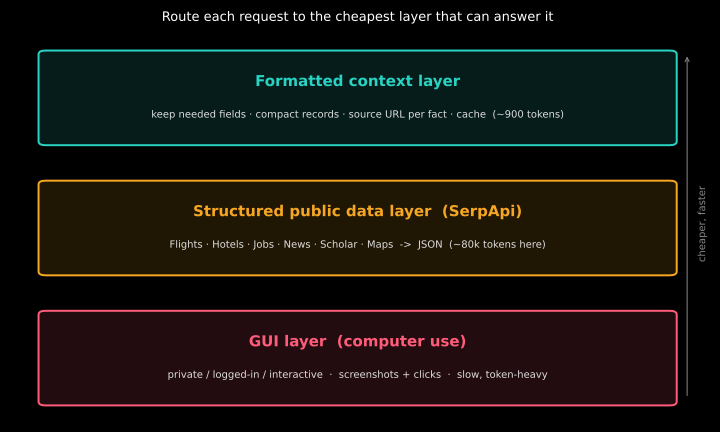
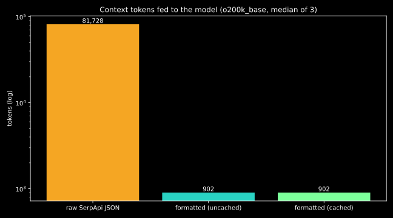
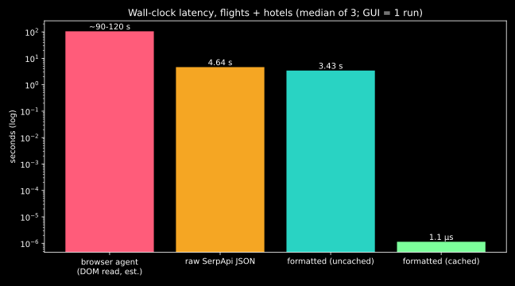

# Agents Don't Need Eyes for the Public Web

*Routing between computer use and structured search, with a formatted context layer on top. All numbers below were measured, not estimated, unless marked otherwise.*

## The problem

AI agents can now use computers the way we do: look at the screen, move the mouse, click, type. That is a real breakthrough. But a GUI is an interface built for human eyes. For an agent it is slow, it costs a lot of tokens, and it breaks easily when a layout changes.

So the question is not *can* an agent use the GUI. It is *should* it, for this request?

## Two kinds of data

- **Private data**: your bank portal, internal HR tool, order history, anything behind a login or anything that changes state (submit, pay, book). Often there is no API. Here the GUI is the right tool.
- **Public data**: flights, hotels, jobs, news, papers, maps. This data is the same for everyone, and it has already been turned into structured JSON by services like **SerpApi**.

Sending an agent to click through Google Flights to read a public price is like printing a web page in order to scan it back in.

## Three layers



1. **GUI layer (computer use).** The fallback. Private, logged-in, interactive work.
2. **Structured public data layer (SerpApi).** Public web surfaces as JSON. No rendering, no scrolling, no captchas.
3. **Formatted context layer.** A thin piece of code between the API and the model. It keeps only the fields the task needs, writes compact records, attaches a source URL to every fact and caches the result.

The point of layer 3: even clean JSON is far too verbose to dump into a prompt.

## The benchmark

Task: *cheapest JNB to AUH flight, out 11 Nov 2026, back 16 Nov 2026, plus 3 hotels in Abu Dhabi for those dates.* SerpApi engines `google_flights` and `google_hotels`, `no_cache=true` on every live call. Tokens counted with tiktoken `o200k_base`. Each path run 3 times; medians reported.

| Layer | Median latency | Median context tokens | Median context size |
|---|---|---|---|
| Browser agent (DOM read)\* | ~90–120 s (1 run) | not measured | not measured |
| Raw SerpApi JSON | 4.64 s | 81,728 | 240,702 bytes |
| Formatted layer, uncached | 3.43 s | 902 | 1,902 bytes |
| Formatted layer, cached | ~1 µs | 902 | 1,902 bytes |




\* The GUI leg was a browser agent that loaded the pages and read the page text (3 actions, 0 screenshots). That is **not** a true pixel-level, screenshot-and-click computer use run, and its end time was estimated. A full screenshot-based run would be slower and costlier, because every step adds an image plus reasoning, but I did not measure one, so I give no number for it.

### What the numbers say

- **Tokens: about 90x fewer.** The raw JSON for two searches is ~82k tokens. The formatted layer gives the model ~900 tokens with the same answer in it. That is the difference between a prompt that fills a context window and one that barely registers.
- **Latency: the API is the cost, not the formatting.** Raw and formatted-uncached both take a few seconds, because both wait on the same live searches. The gap between 4.64 s and 3.43 s is network variance, not a speed-up from formatting (one formatted run took 10.2 s). Formatting itself takes milliseconds.
- **The cache is where latency disappears.** A repeated request is answered in microseconds. Public data like flights should only be cached for minutes; papers or patents can be cached for hours.
- **Against the GUI, it is not close.** Seconds vs. one to two minutes, even for a GUI run that skipped screenshots.

### Is the answer the same?

The formatted context the model actually sees:

```
price|airline|dep|arr|stops|mins|src
703|Etihad|2026-11-11 09:50|2026-11-11 19:45|0|475|https://www.google.com/travel/flights?...
738|Qatar Airways|2026-11-11 13:45|2026-11-12 03:50|1|725|...
```

- **Flights match.** Both paths found Etihad nonstop as the cheapest (SerpApi USD 703, browser ZAR 11,679) and Qatar Airways 1-stop next (USD 738 vs ZAR 12,265). Both pairs imply the same rate of about 16.6 ZAR/USD, so these are the same fares.
- **Hotels differ, and that is a lesson.** The browser read a price-sorted list for one night (Ramada Al Sharia ZAR 1,471 and up). SerpApi's default order is relevance, so it returned Dusit Thani (USD 137, 4.6), Grand Hyatt and Marriott Downtown. Dusit Thani is the one in both lists. Hotel prices also depend on tax display and the nightly vs. total stay. "3 hotels" is underspecified; the agent needs to say *cheapest*, *best rated* or *near X*, and the API lets you pass that as a parameter (`sort_by`) and not leave it to whatever the page shows.

## The router

`router.py` is a deliberately tiny rule-based router: requests that touch *my* account, a login, or a state change go to the GUI; everything else goes to a SerpApi engine and then the formatted layer.

```
Cheapest JNB to AUH flight on 11 Nov        -> public-structured-API (google_flights)
Who is hiring voice AI developer advocates? -> public-structured-API (google_jobs)
Download the invoice from my bank portal    -> private-GUI
Submit my leave form in the internal HR tool -> private-GUI
```

In production this would be a small model call, but the decision is the same: **use the cheapest layer that can answer the request.**

## Takeaways

- Computer use is the fallback, not the default.
- Public data should go through structured APIs; SerpApi already covers most of the public web surfaces agents need.
- Do not feed raw JSON to a model. A formatted context layer cut tokens ~90x here and keeps a source URL on every fact, which helps with grounding.
- Cache public data according to how fast it changes.

## Run it

```bash
python -m venv .venv && . .venv/bin/activate && pip install -r requirements.txt
export SERPAPI_API_KEY=...   # see .env.example
python bench.py      # 3 runs, writes runs.json, results.csv, sample_context.txt
python charts.py     # charts + architecture diagram
python router.py
```

Files: `layer.py` (formatted context layer + cache), `bench.py`, `router.py`, `charts.py`, `results.csv`, `runs.json`.
